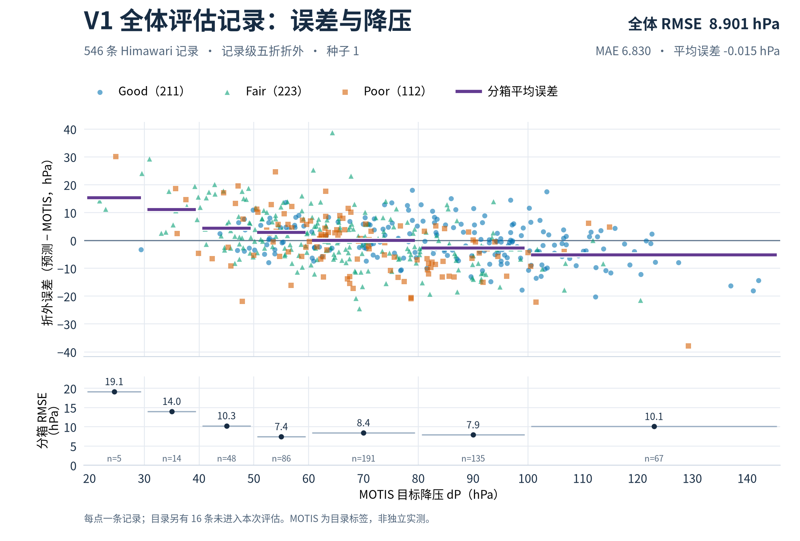
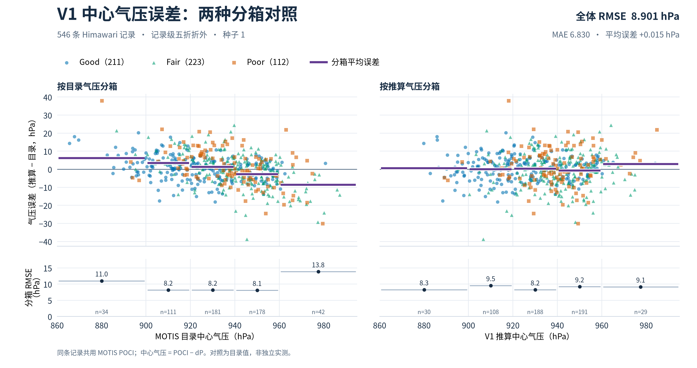

# V1 全体折外误差：降压与中心气压分箱

**已完成，2026-11-22。** 从已有的真实 Himawari 逐记录预测作图，没有重新训练或推理。
范围是种子 1、记录级五折的**全部 546 条评估记录**，每条恰有一次折外预测；
MOTIS 目录另外 16 条未进入这次评估。绘图脚本核对了记录覆盖、折号及根目录 MOTIS 标签。
全体等权 RMSE **8.901 hPa**，MAE **6.830 hPa**，平均误差 **−0.015 hPa**。
这不是独立现场观测测试。训练与预测执行方式见 [V1 报告](README.md)。



下载发布图：[PNG](assets/v1_error_vs_dp.png)（2100×1420） · [矢量 PDF](assets/v1_error_vs_dp.pdf)。

图的上半部分是逐记录误差（预测 dP − MOTIS dP），紫色横线为各降压区间的平均误差；
下半部分给出相同区间的 RMSE 和样本数。分箱左闭右开；单位均为 hPa。

| MOTIS dP | 记录 | 平均误差 | RMSE |
| --- | ---: | ---: | ---: |
| <30 | 5 | +15.312 | 19.141 |
| 30–<40 | 14 | +11.049 | 14.012 |
| 40–<50 | 48 | +4.442 | 10.266 |
| 50–<60 | 86 | +2.830 | 7.442 |
| 60–<80 | 191 | +0.072 | 8.439 |
| 80–<100 | 135 | −2.677 | 7.905 |
| ≥100 | 67 | −5.203 | 10.091 |

**强度增加时，最清楚的变化是偏差由正转负，而非 RMSE 持续增加。** V1 倾向于高估弱样本、
低估强样本；全体平均接近零掩盖了两端偏差。50–<100 hPa 的各箱 RMSE 约 7.4–8.4 hPa，
≥100 hPa 回升至 10.1 hPa。<40 hPa 共 19 条，弱端 RMSE 的具体数值不宜外推。
这种形状符合预测幅度向中间收缩，但不能仅凭残差图确定成因。

## 改按静轨推算中心气压分箱

用**同一批 546 条折外预测**，分别按目录中心气压和 V1 推算中心气压分箱。两边都取同条记录
的根目录 MOTIS POCI：目录中心气压 = POCI − 目录 dP，推算中心气压 = POCI − V1 dP。
两图的气压误差（推算减目录）完全相同，只换了横轴；它与 dP 误差符号相反，
RMSE 不变。这里的环境气压是目录输入，不是静轨模型估计的，也未计入 POCI 的误差。



下载发布图：[PNG](assets/v1_error_vs_pressure_bins.png) · [矢量 PDF](assets/v1_error_vs_pressure_bins.pdf)。

| 中心气压（hPa） | 按目录：记录数 | 偏差 | RMSE | 按推算：记录数 | 偏差 | RMSE |
| --- | ---: | ---: | ---: | ---: | ---: | ---: |
| <900 | 34 | +6.169 | 11.015 | 30 | +0.538 | 8.266 |
| 900–<920 | 111 | +3.517 | 8.175 | 108 | −0.037 | 9.549 |
| 920–<940 | 181 | +1.357 | 8.154 | 188 | +0.266 | 8.240 |
| 940–<960 | 178 | −2.686 | 8.088 | 191 | −0.714 | 9.203 |
| ≥960 | 42 | −8.558 | 13.835 | 29 | +2.842 | 9.141 |

按目录气压分箱，平均误差随气压上升从 +6.17 降到 −8.56 hPa；按推算气压分箱，
**没有同样的单调趋势**。逐记录气压误差与横轴的 Pearson 相关从 −0.415 变为 +0.010。
推算气压 <960 hPa 的四个箱平均偏差均在 ±0.72 hPa 内；≥960 hPa 的 29 条仍有
+2.84 hPa 偏差。各箱 RMSE 为 8.24–9.55 hPa，也没有明显单调变化。

**直接按纯静轨输出 dP 分箱，结果类似。** dP 残差与 V1 dP 的 Pearson 相关为 +0.011。
预测 dP ≥50 hPa 的四个箱（50、60、80、100 hPa 为下界）偏差在 −0.55 至 +0.90 hPa；
预测 dP <50 hPa 的 51 条仍平均低估 3.51 hPa。两种分箱的尾部不能直接一一对应，
因为 POCI 因记录而异。

平方误差下，信息不足时向条件均值收缩很常见。按目录目标分箱，高估弱端、低估强端
可与按预测值分箱后平均残差接近零同时成立：若预测就是输入条件下的均值，
给定预测值的平均残差也应为零。这与「保守估计」的解释一致，但不等于测到了逐条预测的信心，
也不证明每个强度段都已校准。现有结果不支持直接根据目录端的偏差做全局强度修正；
尾部偏差是否稳定，需要更多记录或独立观测检验。

## 产物与复现

发布图随仓库存放于 `docs/V1/assets/`。复现命令将生成图写到外部运行目录
`/mnt/data/H9dP/runs/v1/rotation_seed1/pressure_bin_comparison/`，并打印各分箱统计。
在仓库根目录用 `fy3-aivis-v1` 环境运行，数据全部来自本地。
绘图依赖 Matplotlib 和 Noto Sans CJK SC 字体。

```bash
R=/mnt/data/H9dP/runs/v1/rotation_seed1
S=/mnt/data/H9dP/runs/m1_adapt/data_v1
PYTHONPATH=src:. MKL_THREADING_LAYER=GNU conda run -n fy3-aivis-v1 \
  python -m scripts.plot_v1_errors --predictions "$R/formal/predictions.csv" \
  --source-meta "$S/all_meta.json" --output "$R/pressure_bin_comparison"
```

同环境执行 `MKL_THREADING_LAYER=GNU conda run -n fy3-aivis-v1 python -m pytest -q`，253 项通过。
